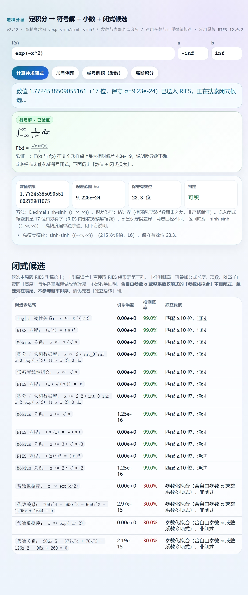

# RIES 积分版 · 定积分与闭式搜索

> 输入一个定积分 → 高精度数值 + 已验证的符号解 + 按置信度排序的闭式候选。
> 完全离线、中文界面、无需构建，打开即用。

**在线演示：<https://dingjifen.pages.dev/>** —— 不用下载安装，打开即算（本仓库为完全离线包）



## 这是什么

本仓库是 **RIES 闭式搜索工具的中文整合版**：在 cybcat 浏览器版 RIES（引擎 v12.0.2）之上，
加了一层自研的**定积分求解层**（v2.16）——任意精度数值求积、符号反导数验证、发散与奇点诊断，
再用「三支柱」把数值结果变成可信闭式：**高精度求积**给出带误差界的真值、
**确定性 BigInt PSLQ 引擎**在明确界定的搜索空间内穷举整数关系（不依赖超时截断）、
**52 位 fail-closed 独立复核 + MDL 描述长度评分**决定每条候选的置信度。

- **`index.html`**：整合版入口，界面全中文（推荐）
- **`ries.html`**：原版英文页面，**未修改任何一行**
- 全部依赖本地化（`assets/` 约 40 MB）：无 CDN、无网络请求、无构建步骤

底层 RIES 算法源自 Robert Munafo（mrob.com）的 RILYBOT Inverse Equation Solver：
双向表达式搜索 + 复杂度排序；浏览器化与数据库模块扩展由 cybcat 完成。详见[致谢与版权](#致谢与版权)。

## 功能亮点

**高精度数值层**（`integral-core.js` / `integral-hp.js`，基于 decimal.js 任意精度）

- exp-sinh / sinh-sinh 双指数求积、自适应 Simpson，有限/无穷/全轴区间自动映射
- 振荡积分专项：chirp 与包络感知换元（`x^q·sin(c·x^p)` 等）+ 半周期 Gauss-Legendre 面板
  + Cohen–Villegas–Zagier 加速；正项振荡用极值分片 + Levin u-transform
- **诚实报位**：保守误差界 σ、可积奇点截断地板、层间差自检——不虚报有效数字
- 发散诊断：定义域缺失守卫、有限端不可积奇点直接判发散短路，不让振荡救援「洗白」假答案

**符号层**（`integral-symbolic.js`，nerdamer 2.0.1）

- 求反导数 F(x)，并在采样点上数值验证 F′(x) = f(x) 后才标注「符号解 · 已验证」
- 分支切割陷阱（如 Weierstrass 换元在周期区间上的跳跃）自动拦截，交回数值层
- 输入规范化：Unicode 符号（`π ² ³ − · ×`）、隐式乘法（`2πx`）、反向区间（`[1,0]`）、`ln`/`log` 等价

**闭式搜索**（新增 `integral-pslq.js` 确定性引擎 + 复用原版 `ries-script.js`）

- **确定性 PSLQ**：纯 BigInt 精确 LLL（Cohen 算法 2.6.7）+ 连分数 + 幂积 + 低次代数关系，
  在明确界定并声明的搜索空间内穷举求解——消除原版引擎 3 秒超时截断与 top-5 挤出导致的漏解
- **55 位经独立验算的常数库**：Euler γ、Catalan G、ζ(3)/ζ(5)/ζ(7)、Dirichlet β(4)、
  Glaisher–Kinkelin、Γ(1/3)/Γ(1/4)/Γ(1/6) 等，直接读取 17~31 位真值不自降精度
- 原版 RIES 引擎继续提供 Möbius / L 函数 / 超几何 / 积分和式数据库与双向表达式搜索
- **Fail-Closed 复核**：每条候选做 55 位独立重算；≥17.5 位精度下未通过复核者概率强制封顶 ≤35%
- **MDL 评分**：候选须带来净信息压缩盈余 ≥6.0 位才放行，从信息论上阻断高维拟合假阳性
- 等价积分/级数变形与含自由参数的「参数化拟合」均不算闭式，单独列在表尾、不参与排序

**体验**

- 运行时中文翻译（`i18n.js`），不改动原版 JS；原版英文页完整保留
- 例题按钮一键演示：收敛、发散、高斯积分
- 可选局域网服务器（`server.js`），手机同网段整包访问

## 快速开始

### 在线：直接打开演示

<https://dingjifen.pages.dev/> —— 与离线包同功能，手机电脑都能用。

### 桌面：直接打开

双击 `index.html`（或拖进浏览器）即可，无需安装任何东西。

### 手机 / 局域网：本地服务器

手机上用文件管理器单开一个 html **不会**加载同目录的脚本和数据库（按钮失效、界面不翻译），
必须整包通过 http 访问：

```bash
npm install     # 仅 express 一个依赖
npm start       # 监听 0.0.0.0:3000
```

然后手机浏览器打开 `http://<电脑局域网IP>:3000`（`/integral.html` 是 `index.html` 的别名）。
服务器默认屏蔽 `server.js`、`package.json`、`tools/` 等内部文件与点文件。

## 示例结果

Node 端到端实测（对照独立核验的闭式真值，完整 132 项见 `npm run test:numeric`）：

| 定积分 | 闭式 | 保守有效位 |
|---|---|---|
| ∫₋∞^∞ e^(−x²) dx | √π | 23.3 位 |
| ∫₀^∞ sin x / x dx | π/2 | 27.0 位 |
| ∫₀^∞ sin(x²) / x² dx | √(π/2) | 27.0 位 |
| ∫₀^∞ sin²x / x² dx | π/2 | 16.2 位 |
| ∫₀¹ ln x / (1+x²) dx | −Catalan G | 25 位 |

发散题（如 `cos(x²)/x` 在 `[0,∞)`、`ln(sin x)` 在 `[0,2π]`）会被正确判定发散并说明原因，而不是给出假值。

新增的确定性 PSLQ 支柱在验收测试中对 28 道闭式题 100% 召回，包括原版引擎因超时或排名挤出而漏掉的形式，
如 `24·ζ(5)`（Bose–Einstein n=4）、`π⁴/15`、`π·ln2`、`−6·β(4)`、Euler γ、`π³/16`、`(12−π²)/6`，
残差普遍在 0～4e-60；同时 15 道非闭式负例（含 x^x、椭圆积分、Si(1) 等）无一被给出高概率误导。

## 测试

```bash
npm run test:framework   # 三支柱系统验收：精度诚实性 10 题 / S_2 确定性召回 28 题 / 非闭式零误导 15 题 + 对抗攻击
npm run test:numeric     # 数值回归 132 项：闭式真值对照、振荡/包络专项、发散守卫、Core/HP 词法一致性
npm run test:weak        # 薄弱点定向 60 项：分支切割、反向区间、Unicode、定义域守卫等
npm run test:glue        # 候选分类：等价积分/级数变形判非闭式
npm run test:server      # 静态服务：入口/别名/资源可达，内部文件 404
npm run build            # 全部 JS 语法检查
```

## 项目结构

```
├── index.html            # 整合版入口（中文，推荐）
├── ries.html             # 原版英文页面（未修改）
├── ries-script.js        # 原版 RIES 12.0.2 引擎（约 677 KB）
├── i18n.js               # 运行时中文翻译层
├── integral-core.js      # 数值层：自适应求积 / 振荡结构识别 / 发散诊断
├── integral-hp.js        # 高精度层：Decimal 双指数 / 换元面板 / CVZ / Levin
├── integral-symbolic.js  # 符号层：反导数 + 导数采样验证
├── integral-pslq.js      # 确定性闭式引擎：BigInt 精确 LLL / 连分数 / 幂积 + 55 位常数库
├── integral-glue.js      # 胶水层：数值送入搜索引擎、fail-closed 复核与 MDL 概率
├── server.js             # 可选局域网静态服务器（express）
├── assets/               # 离线依赖：decimal.js、nerdamer、常数与深度数据表（约 40 MB）
├── tools/                # 三支柱验收 / 回归 / 薄弱点 / 候选分类 / 服务器测试
├── docs/images/          # 截图
├── 使用说明.md            # 详细用法、修复记录与引擎观察
└── UPDATE_GUIDELINES.md  # 上游作者的更新规范
```

技术栈：原生 JavaScript（无框架、无构建）+ decimal.js 10.4.3（MIT）+ nerdamer 2.0.1（许可证遵循上游）
+ express（仅本地服务器可选依赖）。

## 文档

- [使用说明.md](使用说明.md)：完整用法、各版本修复记录（含假答案/虚报位数 bug 的机理与修复）、引擎观察
- [UPDATE_GUIDELINES.md](UPDATE_GUIDELINES.md)：上游仓库的更新规范

## 致谢与版权

- **RIES 算法**：Robert Munafo（mrob.com），RILYBOT Inverse Equation Solver
- **浏览器版与模块扩展**：cybcat（知乎回答《拉马努金模拟器》作者）；本包的原版页面与引擎
  来自其 GitHub Pages 仓库，版权归原作者
- **本仓库**：在上述基础上增加中文本地化、定积分数值/符号层、测试与本地服务器
- **第三方库**：decimal.js（Michael Mclaughlin，MIT）、nerdamer 2.0.1（许可证遵循上游项目）

原版代码版权归原作者；本包仅作学习与研究用途，仓库整体未附加开源许可证。